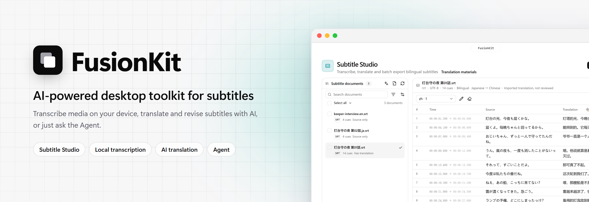
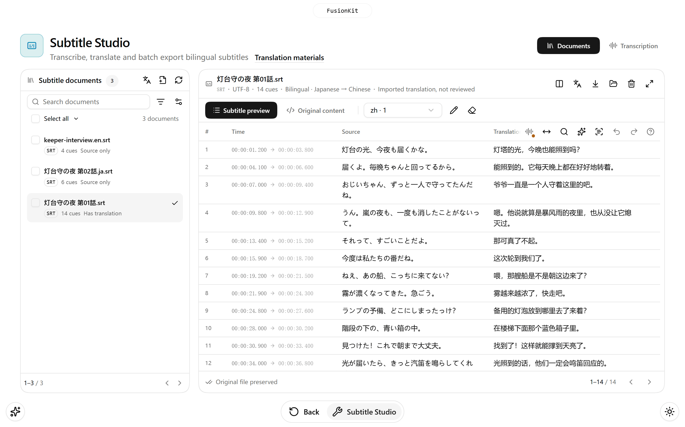
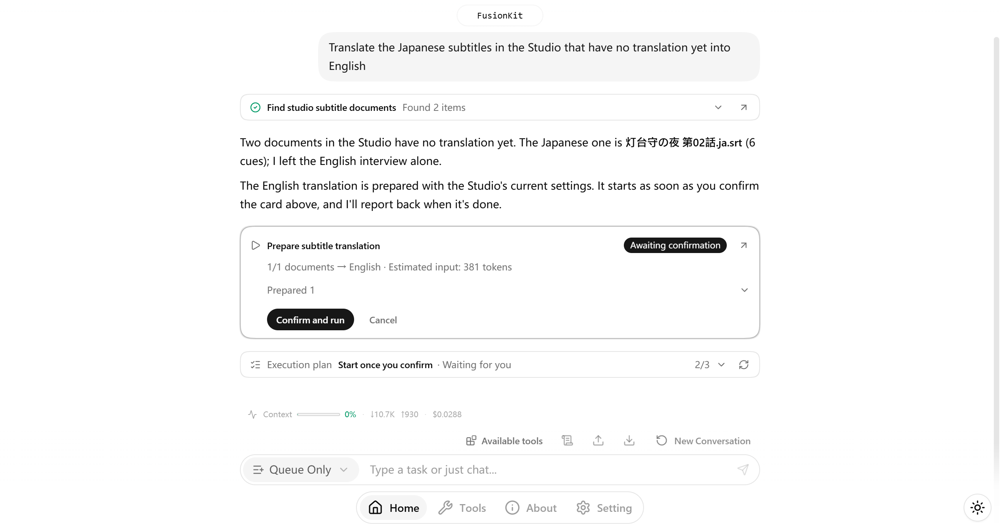
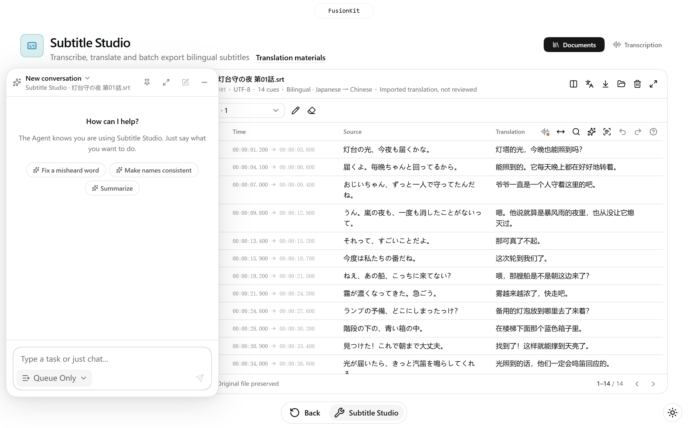
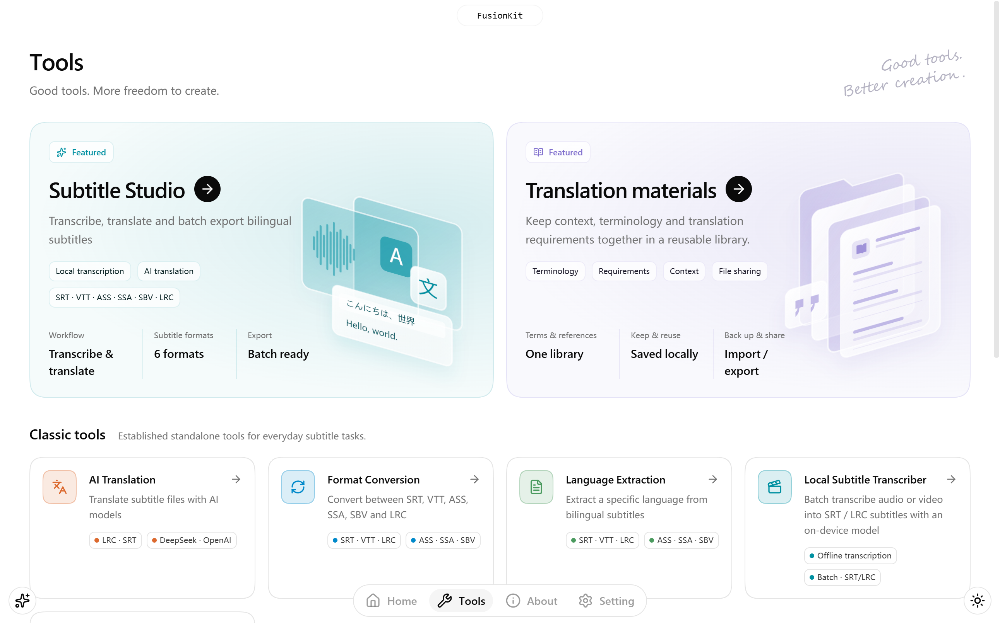

<div align="center">

<picture>
  <source media="(prefers-color-scheme: dark)" srcset="docs/assets/readme/en/banner-dark.png">
  
</picture>

<p>
  <a href="https://github.com/QiuYeDx/FusionKit/releases/latest"></a>
  <a href="https://github.com/QiuYeDx/FusionKit/releases"></a>
  
  
  <a href="LICENSE"></a>
</p>

<p>
  <a href="#download">Download</a> ·
  <a href="#features">Features</a> ·
  <a href="#privacy-and-data">Privacy</a> ·
  <a href="#development">Development</a> ·
  <a href="CHANGELOG.md">Changelog</a> ·
  <a href="README.md">简体中文</a>
</p>

</div>

**FusionKit** is a cross-platform desktop app for working with subtitles and translation. It brings on-device transcription, AI subtitle translation and revision, format conversion and batch export into one workspace, and ships with **FusionKit Agent**: say what you need in one sentence, and the Agent finds the files, prepares the tasks and, once you confirm, carries out the whole workflow.

- **One Subtitle Studio**: transcribe, translate, proofread, listen to the original audio and export, all in one place.
- **Local first**: media is transcribed with Whisper models on your own device and never uploaded; subtitle documents stay on your computer.
- **Reviewable and reversible**: every AI change is shown as a diff first, written only after you confirm, and can be undone.
- **Bring your own API key**: FusionKit does not provide a model API. AI features use your own key for DeepSeek, OpenAI or any OpenAI-compatible service, with live token usage and estimated cost.

## Features

### Subtitle Studio

<picture>
  <source media="(prefers-color-scheme: dark)" srcset="docs/assets/readme/en/studio-dark.png">
  
</picture>

Subtitles are documents you keep working on, and they are still there after you restart the app.

- **Import and organize**: import and export SRT, LRC, VTT, ASS, SSA and SBV. Bilingual subtitles are split into source and translation on import, and a document can keep several translation tracks.
- **Transcribe**: drop in audio or video, pick the audio track, model and VAD, and generate subtitles on your device. Optionally translate automatically and save the result next to the media file when transcription finishes.
- **Translate and revise**: translate a whole document or the selected cues, using the terms and requirements from your translation materials. Describe a fix in plain words ("spell this name the same way everywhere", "this word was misheard") and the AI proposes cue-by-cue revisions with diffs that you apply in one step.
- **Proofread**: edit source and translation inline, merge, split and insert cues, edit or shift timing. Play the original audio of any cue, retime cues with keyboard shortcuts while listening, or re-recognize a few lines with a local model.
- **Batch work**: search, filter and select across pages to translate, export or delete in bulk. Every edit can be undone and redone.

### FusionKit Agent

<picture>
  <source media="(prefers-color-scheme: dark)" srcset="docs/assets/readme/en/agent-dark.png">
  
</picture>

Drive the whole app from a conversation on the home page:

- Look up Studio documents, import subtitles, and prepare transcription and translation tasks. Hand over "transcribe → translate → save subtitles" in one go: the Agent asks for the settings up front, then finishes on its own and reports the results.
- Use subtitle translation, format conversion, language extraction, file name translation and more, and read the real progress of each task. Complex requests get a visible step-by-step plan.
- Three execution modes: **Queue Only**, **Ask Before Execute** and **Auto Execute**. Outside Auto Execute, anything that writes is listed on a card and takes effect only after you confirm.
- Curate translation materials, and optionally verify names on the web (off by default; only search terms are sent).
- Export and import conversations, with live context usage, token counts and cost.

<picture>
  <source media="(prefers-color-scheme: dark)" srcset="docs/assets/readme/en/dock-dark.png">
  
</picture>

On every other page, the Agent button in the bottom-left corner opens a floating panel that shares the same conversation as the home page. The Agent knows which page you are on and what it shows: in the Studio you can say "this word should always be spelled like that", and on a tool page "switch the target language to English".

### External agents (MCP)

Already using Claude Code, Codex, Cursor or another AI agent? Let it work in FusionKit directly. FusionKit serves MCP: an external agent can read Subtitle Studio, import and transcribe, **write its own translations** back into Studio and export subtitle files; it can also split or insert cues, convert subtitle formats, keep one language of bilingual subtitles and rename files to names it translated (undoable), **with no API key configured in FusionKit**.

1. In **Settings → External agents**, turn on “Allow external agents to connect”.
2. Pick your client and follow the steps shown; terminal and desktop versions both work:
   - **Claude Code**: run the command shown in a terminal; the Code tab in the Claude app shares this configuration.
   - **Claude app (Claude Desktop)**: click “Write to config file” (it goes into `claude_desktop_config.json`, with a backup of the previous file), then quit and reopen Claude. It reaches this computer through stdio only.
   - **Codex** (terminal, desktop app and IDE extension share `~/.codex/config.toml`): click “Write to config file”; in the desktop app, click Restart under Settings → MCP servers.
   - **Cursor**: click “Add to Cursor” and confirm in the Cursor desktop app; or write it into `~/.cursor/mcp.json`, or a project's `.cursor/mcp.json`.
   - **Other clients**: copy the configuration; for clients that only take a form, fill in the URL, header or command listed on the page.
   stdio starts FusionKit when it is not running.
3. Optionally install the bundled skill so the agent knows FusionKit's translation workflow.

There are five permission levels: **Read only**, **Ask before changes** (default), **Automatic**, **Full access** and **Custom**. Imports, written translations, exports and other changes ask for your OK in FusionKit (you can allow a kind of change for the rest of a connection); in Automatic, replacing existing files, renaming files and changing translation materials still ask; Full access runs everything without asking; Custom lets you choose Deny, Ask or Allow for each operation (each permission code). Everything an agent does is recorded on this computer in the External agent activity page (click the connection indicator at the top right to open a small panel with links to the page and settings), so changes you allowed for a connection still leave a trail you can review, open or undo. Translations written by an agent are marked as unreviewed AI translations that you can review and undo in Studio. The service listens on 127.0.0.1 only, requires a token and is off by default.

### Translation materials

Group terms, translation requirements and background into a collection per title or streamer, and tick collections (or pick a preset) when translating or revising so names, forms of address and terms stay consistent. Type terms straight into the table; they apply as soon as they are saved and can be disabled one by one. Materials are stored locally and can be shared as `.fktk.json` files with diff previews. Each task pins the version of the materials it used, so later edits never rewrite past tasks.

### More tools

<picture>
  <source media="(prefers-color-scheme: dark)" srcset="docs/assets/readme/en/tools-dark.png">
  
</picture>

| Tool | What it does |
| --- | --- |
| **AI subtitle translation** | Translates LRC / SRT in parallel chunks into 9 languages, bilingual or translation only; interrupted tasks resume from a recovery file |
| **Subtitle format conversion** | Converts between SRT, VTT, LRC, ASS, SSA and SBV, keeping ASS / SSA styling and alignment where possible |
| **Subtitle language extraction** | Extracts one language from bilingual subtitles, keeping the original format |
| **Local subtitle transcription** | Batch-transcribes audio and video to SRT / LRC with local Whisper models and can hand the results to subtitle translation |
| **File and folder name translation** | AI-translates the names you select; review and edit before renaming. Renames run deepest-first, roll back on failure and can be undone |
| **Long text translation** (Beta) | Translates TXT novels and long documents, with a coherent sequential mode, pause and resume, and re-translation from a chosen chunk |

Also included: dark and light themes; Simplified Chinese, Traditional Chinese, English and Japanese interfaces; in-app updates; system or custom proxy; notifications when tasks finish; and sleep prevention during long tasks.

## Download

Get the installer for your platform from [Releases](https://github.com/QiuYeDx/FusionKit/releases/latest):

| Platform | Architecture | Package |
| --- | --- | --- |
| macOS | Apple Silicon (arm64) | `.dmg` / `.zip` |
| Windows | x64 | `.exe` (NSIS installer) |

### System requirements

- **Windows**: Windows 10 or 11, 64-bit (x64). About 850 MB after installing; the Microsoft VC++ runtime it needs comes with the installer and is installed when missing.
- **macOS**: macOS 12 or later, Apple silicon only (M1 or newer).
- **Local transcription**: the recommended transcription model needs about 1 GB more, downloaded in the app with one click; no Python, FFmpeg or CUDA to install.

### If FusionKit won't open

The installers are not signed with paid Apple or Microsoft certificates, so the system may stop FusionKit the first time. Nothing is wrong with the file; allow it once as described below (Help in the app has the same steps):

- **macOS says the developer cannot be verified, or the app cannot be opened**: close the message, open System Settings → Privacy & Security, find the note about FusionKit near the bottom, click "Open Anyway" and enter your password. On macOS 12 it is System Preferences → Security & Privacy → General.
- **macOS says "FusionKit is damaged and can't be opened"**: the file is not broken; macOS marks apps downloaded from the internet. Drag FusionKit into the Applications folder first, open Terminal, paste this command, press Return and open FusionKit again. It only removes the download mark and does not change the app:

  ```sh
  xattr -dr com.apple.quarantine /Applications/FusionKit.app
  ```

- **Windows says "Windows protected your PC"** (SmartScreen): click "More info", then "Run anyway".
- **FusionKit won't open on macOS after you update it**: the first launch of a new version may need to be allowed once more, in the same way.

The DMG also contains a help page with these steps, "打不开请看这里 Can't open".

### Getting started

1. The first launch opens a setup guide. Choose **DeepSeek** (reachable from mainland China and inexpensive), click "Get key" to create a key, paste it and click "Test and save": the Agent and translation tasks can use it right away. You can also choose another service (OpenAI or any OpenAI-compatible API), or external agents if you use Claude Code, Codex or Cursor, which need no key. Change it later under **Setting → AI Model**, or reopen the guide from the Help page.
2. For local transcription, click **Prepare in one click (recommended)** in the setup guide or under "Manage resources" on Subtitle Studio's transcription page. It installs the recommended model (about 1.0 GB) and voice detection, in the background. When the official download addresses cannot be reached, mirrors in mainland China are used automatically, or choose the download source under **Setting → Network**; every file is checked against the official record after it downloads. On Windows the installer sets up the Microsoft runtime, and the app can repair it with one click.
3. Go back to the home page and tell the Agent what you need, or open a tool from the **Tools** page and work with it directly.

With Clash or a similar proxy app, turning on its "system proxy" is enough: FusionKit follows the system proxy by default. The Windows version downloads and installs new versions in the app; the macOS version links to the new DMG. If something goes wrong, start with **Help** in the bottom navigation.

Local transcription runs on Windows x64 (CPU / CUDA) and macOS arm64 (Metal / CPU); its speed depends on your hardware, the model size and the media. Resource sizes, disk space and platform support are covered in the [local subtitle transcription notes](docs/v0.2.11/local-subtitle-transcriber/local-subtitle-transcriber_release_notes.md) (in Chinese).

## Privacy and data

FusionKit has no server of its own and collects no usage data. Apart from resource downloads, update checks and network tests you start yourself, data only goes to the services you configure:

| When | What is sent, and where |
| --- | --- |
| Local transcription | Nothing by default: media and subtitles stay on your device |
| Transcription resources and the changelog | The model, voice detection and NVIDIA pack come from their official addresses; with the download source set to "Auto" or "Mirror First", third-party mirrors are used too (ModelScope, hf-mirror.com, jsDelivr, ghfast.top, ghproxy.net). Only the files are requested and none of your content is sent; every resource is checked against its fixed size and SHA-256 after download. The changelog may also come through jsDelivr or ghfast.top |
| Network test (manual) | When you click Test in Settings → Network: the configured model service addresses (no key is sent), the current download source and GitHub, only to see whether they can be reached |
| AI translation, revision and the Agent | Subtitle or text content goes to the model service in your settings |
| Web lookup (off by default) | Only search terms and page links; never subtitles or translation materials |
| External agents (off by default) | Listens on 127.0.0.1 only and requires a token; subtitles an external agent reads are handled by that agent's own model service |
| Update checks | GitHub Releases, for new version information; the mirrors ghfast.top and ghproxy.net when GitHub cannot be reached (installed in the app only when GitHub or two mirrors agree; when a mirror answers first, GitHub is asked once more to confirm) |

API keys are kept in the app's local settings and used only to call the services you configured. They are never written to subtitle recovery files, long text workspaces or error details. Before using a third-party model service, check its privacy and data retention policy. Some features, such as the sequential long text mode, use more tokens; your provider's bill is the source of truth for cost.

## Development

### Requirements

- Node.js 18 or later
- pnpm 8 (the lockfile is v6; use pnpm 8.7.0, for example through [Corepack](https://nodejs.org/api/corepack.html), so the lockfile is not upgraded)

### Run locally

```bash
git clone https://github.com/QiuYeDx/FusionKit.git
cd FusionKit
pnpm install
pnpm dev
```

### Test

```bash
pnpm test
```

`pnpm test` builds a test bundle and runs every test with Vitest. To run one file, use for example `pnpm exec vitest run test/subtitle-studio/cue-editing-ui.test.ts`.

Many tests launch a real FusionKit window. So they don't get in your way while you use the computer, these windows run in **quiet mode** by default: rendered off-screen, kept out of the taskbar, never taking focus, never going full screen, posting notifications or playing sound. To watch a run, switch modes:

| Command | Windows |
| --- | --- |
| `pnpm test` | Quiet mode (default) |
| `pnpm test:inactive [test files...]` | Shown on screen, but never take focus or go full screen; still muted |
| `pnpm test:visible [test files...]` | Exactly like the app in normal use |

You can also set `FUSIONKIT_TEST_WINDOW` (`quiet` / `inactive` / `visible`) and run `vitest` directly; see `electron/main/test-window-mode.ts`. Some UI tests only run behind an extra switch (such as `FUSIONKIT_STUDIO_E2E=1`); see the `describe.runIf` condition at the top of each test file.

Other checks:

```bash
pnpm i18n:check
```

### Build

```bash
pnpm build
```

The output goes to `release`. The build verifies and packages the native resources used by local transcription and Subtitle Studio (`build/*-resources`, not tracked in Git) and stops if they are missing or fail verification. macOS signing and notarization are described in the [release signing notes](docs/features/subtitle-studio/records/2026-09-14-release-signing-readiness.md) (in Chinese).

### Tech stack

| Area | Technology |
| --- | --- |
| App | Electron 41 · React 19 · TypeScript |
| Build | Vite 5 · electron-builder |
| UI | Tailwind CSS 4 · shadcn/ui (Radix UI) · Motion |
| State and i18n | Zustand · i18next |
| AI | Vercel AI SDK · OpenAI Compatible Provider |
| Local transcription | whisper.cpp · Silero VAD · FFmpeg |
| Testing | Vitest · Playwright |

### Project layout

```
FusionKit/
├── electron/
│   ├── main/        # Main process: windows, IPC, translation / transcription / conversion engines, file system, updates
│   └── preload/     # Preload scripts (Context Bridge)
├── src/
│   ├── agent/       # FusionKit Agent: orchestration, tool definitions, sessions
│   ├── pages/       # Pages: home Agent, tools, Subtitle Studio, translation materials, settings
│   ├── components/  # UI components (shadcn/ui and custom components)
│   ├── subtitle-studio/ · translation-knowledge/ · services/ · store/
│   └── locales/     # Interface translations
├── scripts/         # Build checks, i18n checks and README screenshot scripts
├── test/            # Unit, integration and Electron UI tests
└── docs/            # Design and development docs
```

### Contributing

Issues and pull requests are welcome:

1. Search the existing [issues](https://github.com/QiuYeDx/FusionKit/issues) first. When reporting a bug, include your OS, the app version and steps to reproduce.
2. Branch from `main` and follow [Conventional Commits](https://www.conventionalcommits.org/) (for example `feat(subtitle-studio): ...` or `fix: ...`).
3. When you change interface text, update every language under `src/locales` and run `pnpm i18n:check`.
4. Make sure `pnpm test` passes, then open a pull request and fill in the template.

The screenshots in this README are generated from the real app by `scripts/readme-screenshots`. After UI changes, regenerate them with:

```bash
node scripts/readme-screenshots/capture.mjs en
```

## License

FusionKit is released under the [PolyForm Noncommercial License 1.0.0](LICENSE): you may read, use, modify and share the source, **for noncommercial purposes only**. Third-party components shipped with the app keep their own licenses.

## Acknowledgements

FusionKit is built on many excellent open source projects, including [Electron](https://www.electronjs.org/), [React](https://react.dev/), [whisper.cpp](https://github.com/ggml-org/whisper.cpp), [FFmpeg](https://ffmpeg.org/), [Silero VAD](https://github.com/snakers4/silero-vad), [Vercel AI SDK](https://ai-sdk.dev/), [shadcn/ui](https://ui.shadcn.com/) and [Radix UI](https://www.radix-ui.com/).

<div align="center">
<sub>Made by <a href="https://qiuvision.com">QiuYeDx</a> · <a href="https://github.com/QiuYeDx/FusionKit/issues">Report an issue</a></sub>
</div>
