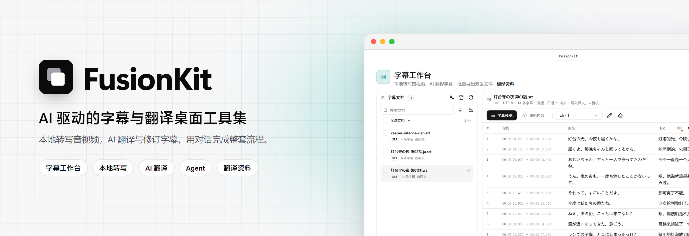
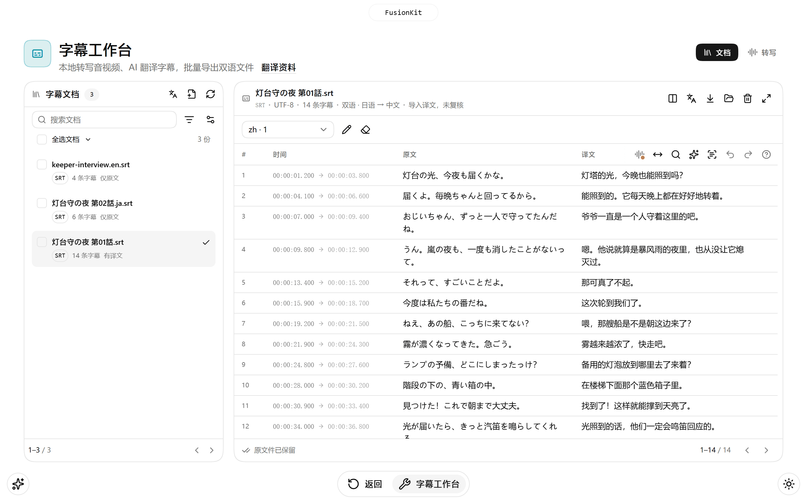
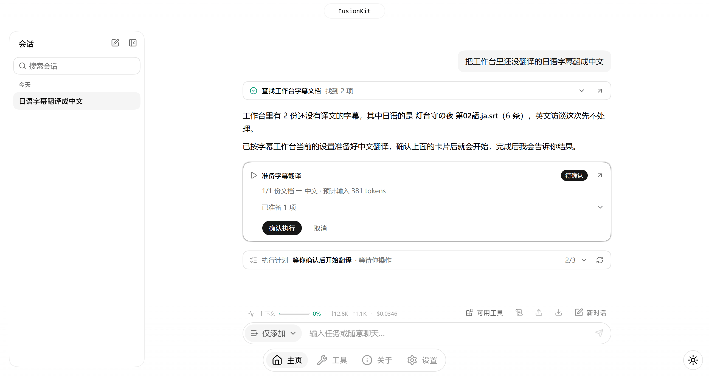
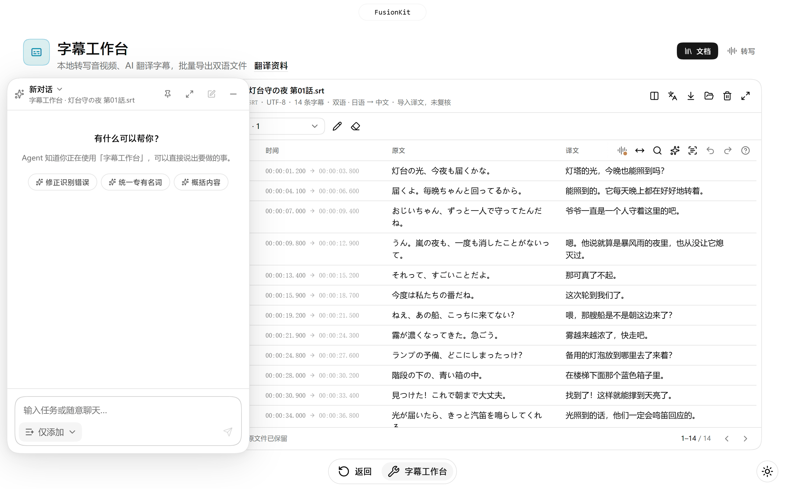
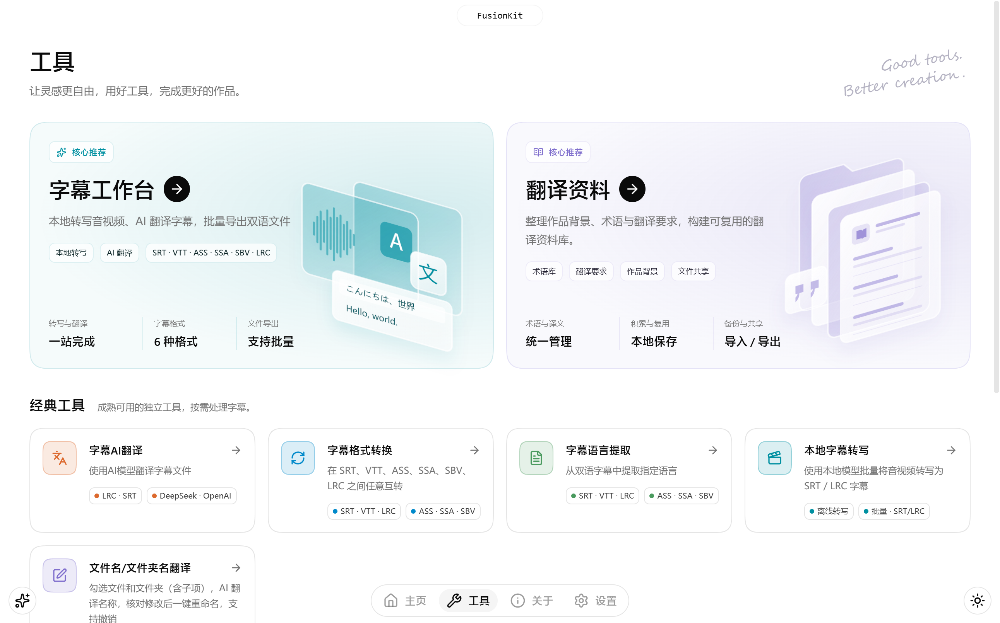

<div align="center">

<picture>
  <source media="(prefers-color-scheme: dark)" srcset="docs/assets/readme/zh/banner-dark.png">
  
</picture>

<p>
  <a href="https://github.com/QiuYeDx/FusionKit/releases/latest"></a>
  <a href="https://github.com/QiuYeDx/FusionKit/releases"></a>
  
  
  <a href="LICENSE"></a>
</p>

<p>
  <a href="#下载安装">下载安装</a> ·
  <a href="#功能">功能</a> ·
  <a href="#隐私与数据">隐私与数据</a> ·
  <a href="#参与开发">参与开发</a> ·
  <a href="CHANGELOG.md">更新日志</a> ·
  <a href="README.en.md">English</a>
</p>

</div>

**FusionKit** 是一款面向字幕与翻译工作的跨平台桌面应用。它把本地音视频转写、AI 字幕翻译与修订、格式转换和批量导出放进同一个工作台，并内置 **FusionKit Agent**：用一句话说明要做的事，Agent 会查找文件、准备任务，在你确认后完成整套流程。

- **一站式字幕工作台**：转写、翻译、校对、试听原声、导出，全部在一个地方完成。
- **本地优先**：音视频转写使用设备上的 Whisper 模型，媒体文件不会上传；字幕文档保存在本机。
- **可审可撤**：AI 的每一次修改都先预览差异，由你确认后才写入，并且可以撤销。
- **接入你自己的模型服务**：应用不提供模型 API，AI 功能需要配置你自己的 API Key；支持 DeepSeek、OpenAI 及任意 OpenAI 兼容接口，Token 用量与预估费用实时可见。

## 功能

### 字幕工作台

<picture>
  <source media="(prefers-color-scheme: dark)" srcset="docs/assets/readme/zh/studio-dark.png">
  
</picture>

把字幕当作可以持续编辑的文档来管理，关闭应用后再打开也不会丢失。

- **导入与整理**：支持 SRT、LRC、VTT、ASS、SSA、SBV 的导入与导出；导入双语字幕时自动拆分为原文与译文，可保留多个译文轨。
- **转写**：拖入音频或视频，选择音轨、模型与 VAD，在本机生成字幕；可设置转写完成后自动翻译、自动导出到媒体文件旁。
- **翻译与修订**：整份或按所选字幕翻译，可选用翻译资料中的术语与要求；用自然语言描述要改的地方（如“统一人名写法”“纠正误识别的词”），AI 逐条给出修订和差异，确认后一次应用。
- **校对**：行内编辑原文与译文，合并、拆分、插入字幕，修改与整体平移时间；试听每句对应的原声，边听边用快捷键重新定时间，或用本机模型重新识别某几句。
- **批量操作**：搜索、筛选、跨页多选后批量翻译、导出或删除；所有编辑都支持撤销与重做。

### FusionKit Agent

<picture>
  <source media="(prefers-color-scheme: dark)" srcset="docs/assets/readme/zh/agent-dark.png">
  
</picture>

在首页用对话驱动整个应用：

- 查询工作台文档、导入字幕、准备转写与翻译任务；可以一次交办“转写 → 翻译 → 保存字幕”，Agent 问清设置后自动完成并汇报结果。
- 调用字幕翻译、格式转换、语言提取、文件名翻译等工具，读取任务的真实进度；复杂请求会生成可见的执行计划。
- 三种执行模式：**仅添加**、**询问执行**、**自动执行**。除自动执行外，涉及写入的操作都会以卡片列出，确认后才生效。
- 可整理翻译资料，并可选择开启联网查证译名（默认关闭，只发送检索词）。
- 会话支持导出与导入，并实时显示上下文占用、Token 用量与费用。

<picture>
  <source media="(prefers-color-scheme: dark)" srcset="docs/assets/readme/zh/dock-dark.png">
  
</picture>

在其他页面，左下角的 Agent 入口会展开一个悬浮面板，与首页共享同一个会话。Agent 了解你所在的页面和当前状态：在工作台里可以直接说“文中的某个词都应该是另一个写法”，在工具页可以说“把目标语言改成英文”。

### 翻译资料

按作品或主播把术语、翻译要求和背景整理成资料集，翻译与修订时勾选资料集或直接选用预设，保证人名、称谓和术语前后一致。在表格里直接录入术语，保存即生效，可单条停用；资料保存在本地，支持 `.fktk.json` 导入导出与差异预览；任务会固定所用资料的版本，事后修改资料不会改写历史任务。

### 更多工具

<picture>
  <source media="(prefers-color-scheme: dark)" srcset="docs/assets/readme/zh/tools-dark.png">
  
</picture>

| 工具 | 说明 |
| --- | --- |
| **字幕 AI 翻译** | 分片并发翻译 LRC / SRT，支持 9 种语言、双语或仅译文输出，任务中断后可从恢复清单继续 |
| **字幕格式转换** | 在 SRT、VTT、LRC、ASS、SSA、SBV 之间互转，尽量保留 ASS / SSA 的样式与对齐 |
| **字幕语言提取** | 从双语字幕中提取指定语言，输出保持原格式 |
| **本地字幕转写** | 使用本地 Whisper 模型批量把音视频转写为 SRT / LRC，可交接给字幕翻译 |
| **文件名 / 文件夹名翻译** | 勾选条目后由 AI 翻译名称，核对修改后重命名；按“由深到浅”执行，失败自动回滚，完成后可撤销 |
| **长文本翻译**（Beta） | 面向小说和长文档的 TXT 翻译，支持连贯串行模式、暂停恢复与从指定分片重翻 |
| **音频工具箱** | 音频转文本、文本转语音、实时字幕与实时双向语音，使用 OpenAI 或 MiMo 的音频接口 |

此外：深色 / 浅色主题，简体中文、繁體中文、English、日本語界面，应用内自动更新，系统 / 自定义代理，任务完成通知，长任务期间防止系统休眠。

## 下载安装

前往 [Releases](https://github.com/QiuYeDx/FusionKit/releases/latest) 下载对应平台的安装包：

| 平台 | 架构 | 安装包 |
| --- | --- | --- |
| macOS | Apple Silicon（arm64） | `.dmg` / `.zip` |
| Windows | x64 | `.exe`（NSIS 安装程序） |

首次使用：

1. 打开 **设置 → AI 模型**，添加一个模型配置（填写 API 地址、Key 和模型名），并在“模型分配”中指定 Agent 与任务执行所用的模型。内置 DeepSeek 与 OpenAI 预设。
2. 使用本地转写前，在转写页的资源管理中下载推荐的 Whisper 模型（或导入兼容的 GGML 模型）。模型与 VAD 按需下载，不包含在安装包中。
3. 回到首页，直接告诉 Agent 你要做什么；或从 **工具** 页打开具体工具手动操作。

本地转写支持 Windows x64（CPU / CUDA）与 macOS arm64（Metal / CPU），速度取决于设备性能、模型大小和媒体内容。资源体积、磁盘需求与平台支持详见[本地字幕转写说明](docs/v0.2.11/local-subtitle-transcriber/local-subtitle-transcriber_release_notes.md)。

## 隐私与数据

FusionKit 没有自己的服务器，也不收集使用数据。除检查更新外，数据只会发往你自己配置的服务：

| 场景 | 发送什么、发往哪里 |
| --- | --- |
| 本地转写 | 默认离线，媒体与字幕不出本机；仅下载模型资源时访问固定的下载地址 |
| AI 翻译、修订与 Agent | 字幕或文本内容发送到你在设置中配置的模型服务 |
| 音频工具箱 | 音频文件、录音或麦克风内容发送到你选择的音频服务 |
| 联网查证（默认关闭） | 只发送检索词与网页链接，不发送字幕或翻译资料 |
| 检查更新 | 访问 GitHub Releases 获取新版本信息 |

API Key 保存在本机的应用设置中，只用于请求你配置的服务，不会写入字幕翻译恢复清单、长文本翻译工作区、音频任务数据或错误详情。使用第三方模型服务前，请确认其隐私与数据保留政策；长文本串行模式等功能会增加 Token 用量，费用以服务商账单为准。

## 参与开发

### 环境要求

- Node.js 18 或更高版本
- pnpm 8（仓库锁文件为 lockfile v6，建议通过 [Corepack](https://nodejs.org/api/corepack.html) 使用 pnpm 8.7.0，避免升级锁文件）

### 本地运行

```bash
git clone https://github.com/QiuYeDx/FusionKit.git
cd FusionKit
pnpm install
pnpm dev
```

### 测试

```bash
pnpm test
```

`pnpm test` 会先构建测试包，再用 Vitest 运行全部测试；也可以只运行单个文件，例如 `pnpm exec vitest run test/subtitle-studio/cue-editing-ui.test.ts`。

许多测试会启动真实的 FusionKit 窗口。为了不打扰正在使用电脑的你，这些窗口默认以**静默模式**运行：在屏幕外渲染、不出现在任务栏、不抢占焦点，也不会全屏、弹出通知或发出声音。需要观看测试画面时可以切换：

| 命令 | 窗口表现 |
| --- | --- |
| `pnpm test` | 静默模式（默认） |
| `pnpm test:inactive [测试文件...]` | 显示在屏幕上，但不抢占焦点、不全屏，同样静音 |
| `pnpm test:visible [测试文件...]` | 与正常运行应用完全一致 |

也可以直接设置环境变量 `FUSIONKIT_TEST_WINDOW`（`quiet` / `inactive` / `visible`）后运行 `vitest`，实现见 `electron/main/test-window-mode.ts`。部分界面测试需要额外的开关才会运行（如 `FUSIONKIT_STUDIO_E2E=1`），见各测试文件开头的 `describe.runIf` 条件。

其他检查：

```bash
pnpm i18n:check
```

### 构建

```bash
pnpm build
```

产物输出到 `release` 目录。构建会校验并打包本地转写与字幕工作台所需的原生资源（`build/*-resources`，不随 Git 同步），缺失或校验失败时会拒绝继续。macOS 签名与公证步骤见[发布签名与许可说明](docs/features/subtitle-studio/records/2026-09-14-release-signing-readiness.md)。

### 技术栈

| 分类 | 技术 |
| --- | --- |
| 应用框架 | Electron 41 · React 19 · TypeScript |
| 构建 | Vite 5 · electron-builder |
| 界面 | Tailwind CSS 4 · shadcn/ui（Radix UI）· Motion |
| 状态与国际化 | Zustand · i18next |
| AI | Vercel AI SDK · OpenAI Compatible Provider |
| 本地转写 | whisper.cpp · Silero VAD · FFmpeg |
| 测试 | Vitest · Playwright |

### 目录结构

```
FusionKit/
├── electron/
│   ├── main/        # 主进程：窗口、IPC、翻译 / 转写 / 转换引擎、文件系统与更新
│   └── preload/     # 预加载脚本（Context Bridge）
├── src/
│   ├── agent/       # FusionKit Agent：编排、工具定义与会话
│   ├── pages/       # 页面：首页 Agent、工具页、字幕工作台、翻译资料、设置
│   ├── components/  # UI 组件（shadcn/ui 与自定义组件）
│   ├── subtitle-studio/ · translation-knowledge/ · services/ · store/
│   └── locales/     # 界面多语言资源
├── scripts/         # 构建检查、i18n 检查与 README 截图脚本
├── test/            # 单元、集成与 Electron 界面测试
└── docs/            # 设计与开发文档
```

### 提交贡献

欢迎提交 Issue 与 Pull Request：

1. 提交前请先搜索已有 [Issues](https://github.com/QiuYeDx/FusionKit/issues)，描述问题时附上系统、版本与复现步骤。
2. 从 `main` 创建分支开发，提交信息遵循 [Conventional Commits](https://www.conventionalcommits.org/)（如 `feat(subtitle-studio): ...`、`fix: ...`）。
3. 涉及界面文案时同步更新 `src/locales` 下的各语言资源，并运行 `pnpm i18n:check`。
4. 确认 `pnpm test` 通过后发起 Pull Request，按模板说明改动与验证方式。

README 中的截图由 `scripts/readme-screenshots` 在真实应用中生成，界面变化后可以重新运行：

```bash
node scripts/readme-screenshots/capture.mjs zh
```

## 许可证

FusionKit 以 [PolyForm Noncommercial License 1.0.0](LICENSE) 发布：可以自由查看、使用、修改和分发源码，但**仅限非商业用途**。随应用分发的第三方组件遵循各自的许可证。

## 致谢

FusionKit 构建在许多优秀的开源项目之上，包括 [Electron](https://www.electronjs.org/)、[React](https://react.dev/)、[whisper.cpp](https://github.com/ggml-org/whisper.cpp)、[FFmpeg](https://ffmpeg.org/)、[Silero VAD](https://github.com/snakers4/silero-vad)、[Vercel AI SDK](https://ai-sdk.dev/)、[shadcn/ui](https://ui.shadcn.com/) 与 [Radix UI](https://www.radix-ui.com/)。

<div align="center">
<sub>由 <a href="https://qiuvision.com">QiuYeDx</a> 制作 · <a href="https://github.com/QiuYeDx/FusionKit/issues">反馈问题</a></sub>
</div>
